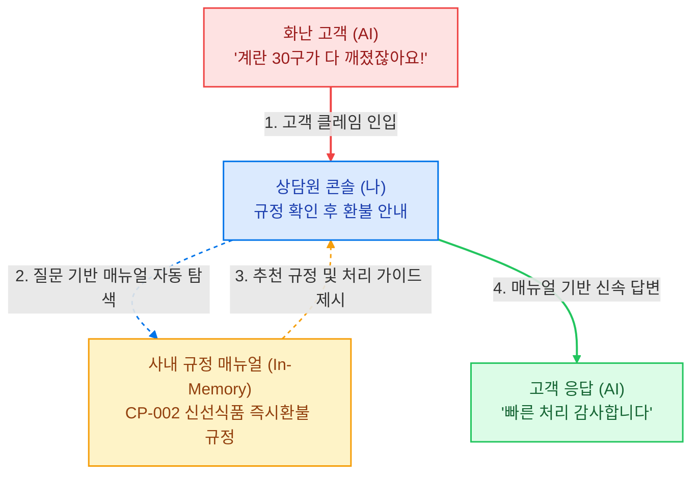

# 쿠팡 고객탄식센터 CS 콘솔

> **역할 반전(Role-Reversal) 기반의 실시간 CS 상담 시뮬레이터**  
> 사용자가 상담원 역할을 맡고, AI가 불만을 제기하는 고객 페르소나를 수행하며, 인메모리 RAG 엔진이 실시간으로 사내 규정을 추천합니다.

 

 
 

---

## 💡 작동 구조

---

## 📖 실시간 RAG 엔진 구성

- **한국어 하이브리드 검색**: 단순 텍스트 일치가 아닌, 한국어 형태소 분절과 문자 단위 Bi-gram 토큰화, 필드별 가중치 알고리즘을 구현했습니다.
- **In-Memory 초경량 탐색**: 외부 네트워크 통신 레이턴시를 배제하고 Vercel Serverless 메모리 내에서 1ms 미만으로 규정을 탐색합니다.
- **쿠팡 공식 규정 12개 청크 내장 (CP-001 ~ CP-012)**: 신선식품 파손 즉시 환불, 프레시백 보증금(8,000원), 와우 멤버십 중도 해지, 감정노동자 보호법 등 실제 약관이 매핑되어 있습니다.
- **근거 투명성 (Explainable AI)**: 고객 질문에 따라 참조한 매뉴얼 ID, 섹션명, 유사도 점수, 원문 내용을 상담원 화면 우측에 실시간 카드로 시각화합니다.
- **확장성 (Scalability)**: 데이터가 방대해질 경우 Upstash Vector(서버리스 벡터DB) 또는 Supabase pgvector를 연동할 수 있도록 모듈화되어 있습니다.

---

## 주요 기능

1. **역할 반전 시뮬레이션 (Role-Reversal)**
   - 일반적인 챗봇과 반대로 사용자가 '상담원'이 되고 AI가 불만을 제기하는 '고객' 역할을 수행합니다.
   - 상담원의 규정 준수 여부와 응대 어조에 따라 고객의 감정 상태(분노 지속 또는 완화)가 실시간으로 변화합니다.

2. **12종 실무 CS 시나리오**
   - 신선식품 파손, 전자기기 패키지 훼손, 프레시백 보증금 분쟁, 배송 지연 등 실제 이커머스 사례 기반의 12개 시나리오를 무작위로 배정합니다.

3. **실시간 스트리밍 및 응답 최적화**
   - Vercel AI SDK 텍스트 스트리밍을 통해 대기 시간 없이 고객 메시지가 실시간으로 타이핑됩니다.
   - 모바일 구어체에 맞춘 토큰 최적화(`maxOutputTokens: 150`)로 자연스러운 메신저 대화 톤을 유지합니다.

4. **OS / 브라우저 테마 자동 감지**
   - 접속 시 사용자의 운영체제 및 브라우저 테마(다크/라이트)를 기본으로 자동 반영하며, 상단 버튼으로 언제든 수동 전환할 수 있습니다.

---

## 기술 스택

- **Frontend**: Next.js 16 (App Router, TypeScript)
- **AI Engine**: Vercel AI SDK (`ai`, `@ai-sdk/openai`, `@ai-sdk/google`)
- **LLM Provider**: Groq (`qwen/qwen3.8-27b`), Google Gemini (`gemini-3.1-flash-lite`)
- **Search**: In-Memory Bi-gram Hybrid Search (`src/lib/search.ts`)
- **Styling**: Tailwind CSS v4, Lucide React
- **Deployment**: Vercel Serverless
